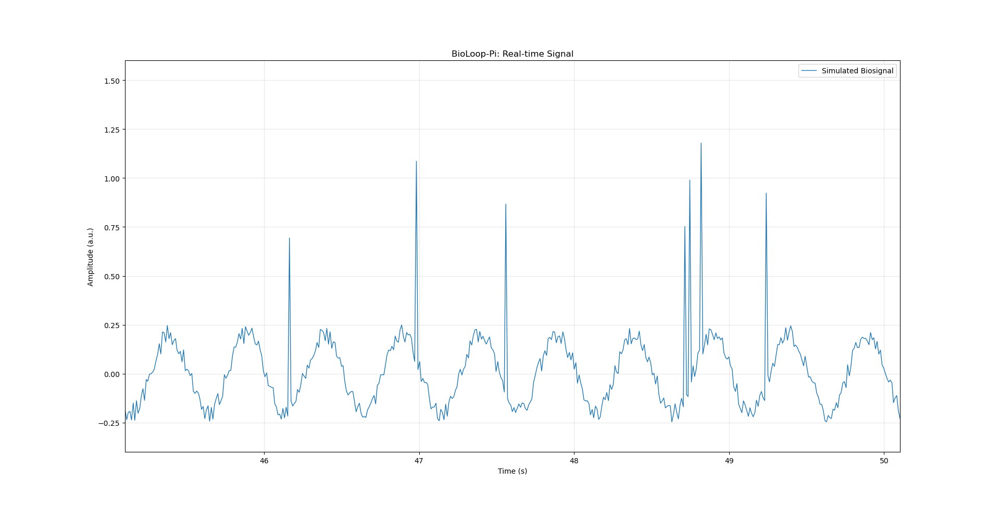

# Phase 1-8 — Real-time Signal Visualization

**Date:** 2026-10-25  
**Project:** BioLoop-Pi  
**Environment:** Raspberry Pi Pico 2 W, Raspberry Pi 5, MicroPython, Python, Matplotlib

## 1. Objective

이번 단계에서는 Raspberry Pi Pico 2 W에서 생성하는 가상 생체신호를 Raspberry Pi 5에서 실시간으로 수신하고, HDMI 모니터를 통해 파형을 시각화하는 시스템을 구현하였다.

기존 Phase 1-6에서는 CSV에 저장된 데이터를 불러와 정적인 그래프를 생성하였다. 이번에는 USB Serial로 수신되는 데이터를 버퍼에 저장하면서 그래프를 주기적으로 갱신하는 기능을 추가하였다.

## 2. System Architecture

```text
Raspberry Pi Pico 2 W
    |
    | Simulated Biosignal
    | USB Serial
    v
Raspberry Pi 5
    |
    | live_plot.py
    v
Serial Data Reception
    |
    v
Deque Buffer
    |
    v
Matplotlib FuncAnimation
    |
    v
HDMI Monitor
```

- **Pico 2 W:** 가상 생체신호 생성 및 USB Serial 전송
- **Raspberry Pi 5:** 신호 수신, 버퍼 관리 및 시각화
- **HDMI Monitor:** 실시간 파형 확인

## 3. Implementation

**Source:** `raspberry_pi/live_plot.py`

### 3.1 Serial Communication

`pyserial`을 이용하여 Pico 2 W가 전송하는 `timestamp_ms,signal` 형식의 데이터를 수신한다.

수신한 문자열을 파싱하여 Timestamp는 정수형, Signal은 실수형으로 변환한다.

### 3.2 Real-time Buffer

`collections.deque`를 사용하여 Timestamp와 Signal 데이터를 관리하였다.

```python
timestamps = deque(maxlen=1000)
signals = deque(maxlen=1000)
```

최대 1,000개의 샘플을 유지하며, 새로운 샘플이 추가되어 최대 길이를 초과하면 가장 오래된 샘플이 자동으로 제거된다.

이를 통해 데이터가 무한히 누적되는 것을 방지하였다.

### 3.3 Real-time Visualization

`matplotlib.animation.FuncAnimation`을 사용하여 그래프를 반복적으로 갱신하도록 구현하였다.

설정값은 다음과 같다.

| Parameter | Value |
|---|---|
| Serial Port | `/dev/ttyACM0` |
| Baud Rate Setting | 115200 |
| Sliding Window | 5 s |
| Maximum Buffer Length | 1000 samples |
| Animation Interval | 50 ms |
| Target Sampling Rate | 100 Hz |

50 ms는 그래프 갱신 요청 간격으로, 이론적으로 초당 약 20회의 업데이트에 해당한다. 실제 갱신 속도는 별도로 측정하지 않았다.

시간축은 최신 Timestamp를 기준으로 최근 5초 구간을 표시하도록 설정하였다.

## 4. Experimental Result

Raspberry Pi 5에서 `live_plot.py`를 실행하여 Matplotlib 그래프 창에 신호가 표시되는 것을 확인하였다.



*Figure 1. Raspberry Pi 5에서 표시한 가상 생체신호의 실시간 시각화 화면.*

화면에서 다음과 같은 특징이 관찰되었다.

- 약 2 Hz의 주기적인 정현파
- 정현파에 중첩된 작은 진폭의 Random Noise
- 불규칙한 시점에서 발생하는 Burst-like Event
- 약 45~50초에 해당하는 5초 구간의 시간축

관찰된 파형은 `signal_generator.py`에서 정의한 가상 생체신호의 특성과 일치한다.

## 5. Discussion

이번 단계에서는 USB Serial 데이터 수신과 실시간 그래프 표시 기능을 하나의 프로그램으로 통합하였다.

기존의 `receiver.py`는 수신 데이터를 터미널에 표시하고, `logger.py`는 CSV 파일로 저장하며, `plot_signal.py`는 저장된 데이터를 정적으로 시각화하였다.

반면 `live_plot.py`는 신호를 수신하면서 화면을 갱신한다는 차이가 있다.

또한 Sampling Rate와 Visualization Update Rate가 서로 다른 개념임을 확인하였다.

다만 현재 구현에는 다음과 같은 한계가 존재한다.

1. 그래프 화면 캡처만으로 장시간 애니메이션의 안정성이나 실제 갱신 속도까지 검증할 수는 없다.
2. 데이터 수신과 그래프 갱신이 동일한 실행 흐름에서 처리되므로 GUI 부하가 증가하면 수신이 지연될 수 있다.
3. Serial 데이터가 불완전한 상태로 수신되면 파싱 과정에서 해당 데이터를 건너뛸 가능성이 있다.
4. Sample Sequence Number가 없으므로 수신 과정의 데이터 손실 여부를 정확하게 검증하기 어렵다.
5. 현재 신호는 실제 생체신호가 아닌 소프트웨어로 생성한 가상 신호다.

## 6. Conclusion

이번 단계에서 다음 기능을 구현하고 기본 출력 결과를 확인하였다.

- [x] USB Serial 데이터 수신
- [x] Deque 기반 데이터 버퍼링
- [x] Matplotlib Animation 구현
- [x] 5초 Sliding Window 설정
- [x] HDMI 모니터에서 신호 파형 표시 확인
- [ ] 장시간 실시간 갱신 안정성 정량 검증
- [ ] 수신 데이터 손실률 분석
- [ ] 실시간 시각화 성능 최적화

## 7. Next Step

다음 단계에서는 데이터 수집 시스템의 정확도와 안정성을 개선한다.

- Sampling Timing Optimization
- Timestamp Resolution 개선 검토
- Serial Buffering 및 Data Loss 검증
- 실제 ADC 및 생체신호 센서 연동 준비

최종적으로 실제 센서에서 취득한 신호를 실시간으로 수집·분석하고, Closed-loop Feedback으로 확장할 수 있는 기반을 구축하는 것이 목표다.