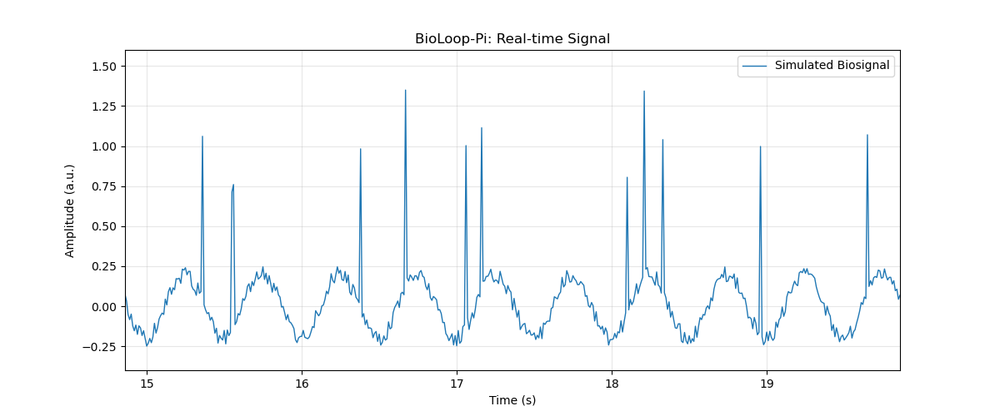

# Phase 2-1 — Sample Sequence Number Integration

**Date:** 2026-11-07  
**Project:** BioLoop-Pi  
**Hardware:** Raspberry Pi Pico 2 W, Raspberry Pi 5  
**Environment:** MicroPython, Python, USB Serial, Matplotlib

---

## 1. Objective

이번 단계에서는 Pico 2 W에서 생성하는 가상 생체신호에 Sample Sequence Number를 추가하여, Raspberry Pi 5에서 수신하는 데이터의 연속성을 검증할 수 있는 기반을 구축하였다.

기존 시스템은 `timestamp_ms`와 `signal`만 기록했기 때문에 샘플링 간격의 변화는 확인할 수 있었지만, 실제 샘플 누락과 샘플링 지연을 명확하게 구분하기 어려웠다.

이를 개선하기 위해 각 샘플에 증가하는 Sequence Number를 부여하고, 데이터 수신·저장·실시간 시각화 프로그램에 새로운 데이터 형식을 적용하였다.

## 2. System Architecture

```text
Raspberry Pi Pico 2 W
  |
  | signal_generator.py
  | Sequence Number + Timestamp + Signal
  |
  v
USB Serial
  |
  v
Raspberry Pi 5
  |
  +-- receiver.py  → Terminal Output
  |
  +-- logger.py    → CSV Data Logging
  |
  +-- live_plot.py → Real-time Visualization
```

### Data Format

**Before**

```csv
timestamp_ms,signal
1000,0.1523
1010,0.1634
```

**After**

```csv
seq,timestamp_ms,signal
100,1000,0.1523
101,1010,0.1634
```

- `seq`: Pico가 생성·출력을 시도한 샘플의 순번
- `timestamp_ms`: Pico의 시작 시점부터 경과한 시간
- `signal`: 생성된 가상 생체신호 값

## 3. Implementation

### 3.1 Pico — Sequence Number Generation

**File:** `pico/signal_generator.py`

```python
sequence = 0

while True:
    # Signal generation and timing control
    ...

    print("{},{},{}".format(
        sequence,
        elapsed_ms,
        signal
    ))

    sequence += 1
```

Sequence Number는 반복문 밖에서 초기화하여 각 반복에서 값이 유지되도록 하였다.

기존 Phase 1-9에서 구현한 Periodic Scheduling 구조는 그대로 유지하였다.

### 3.2 Raspberry Pi — Serial Receiver

**File:** `raspberry_pi/receiver.py`

USB Serial을 통해 전달된 데이터를 쉼표로 분리한 뒤 정수형과 실수형으로 변환하도록 수정하였다.

```python
seq_str, timestamp_str, signal_str = raw_data.split(",")

sequence = int(seq_str)
timestamp_ms = int(timestamp_str)
signal = float(signal_str)
```

### 3.3 Raspberry Pi — Data Logger

**File:** `raspberry_pi/logger.py`

기존 Logger 구조를 유지하면서 CSV Header와 데이터 저장 항목에 `seq`를 추가하였다.

```python
writer.writerow([
    "seq",
    "timestamp_ms",
    "signal"
])
```

`sequence`는 Pico에서 전달된 샘플 번호이고, `sample_count`는 Raspberry Pi가 실제 CSV에 기록한 샘플 개수이다.

### 3.4 Raspberry Pi — Real-time Visualization

**File:** `raspberry_pi/live_plot.py`

새로운 3개 필드 형식을 처리하도록 Serial Parsing 코드를 변경하였다.

그래프는 기존처럼 Timestamp를 X축으로, Signal을 Y축으로 사용하였다. Sequence Number는 그래프 표시에는 직접 사용하지 않는다.

## 4. Experimental Results

### 4.1 Serial Reception Test

`receiver.py` 실행 결과, Sequence Number가 연속적으로 증가하는 것을 확인하였다.

```text
seq=1738 | time=17380 ms | signal=-0.1576
seq=1739 | time=17390 ms | signal=-0.2333
seq=1740 | time=17400 ms | signal=-0.1612
...
seq=1752 | time=17520 ms | signal=0.0938
```

관찰한 15개 샘플 구간에서는 Sequence Number가 매번 1씩 증가했고, Timestamp 간격은 10 ms였다.

### 4.2 CSV Logging Test

`logger.py` 실행 후 다음 형식의 CSV 저장을 확인하였다.

```csv
seq,timestamp_ms,signal
9765,97650,0.23772826
9766,97660,0.21820242
9767,97670,0.16456772
```

CSV 저장 기능 자체는 정상 동작하였다.

그러나 원본 CSV에서 다음과 같은 이상 기록을 발견하였다.

```csv
9770,97700,0.10144627
9779772,97720,0.069109048
9773,97730,0.0063999852
```

`9779772`는 정수로 변환할 수 있지만 정상적인 Sequence Number 증가 규칙에 맞지 않는 값이다.

임시 분석 코드로 전체 CSV를 검사한 결과:

```text
Line 8: previous=9770, current=9779772
Line 9: previous=9779772, current=9773

Total sequence discontinuities: 2
```

두 번의 불연속은 하나의 비정상적인 행을 기준으로 발생하였다.

9771번 샘플은 기록에서 확인되지 않았으며, `97720ms` 행의 Sequence Number가 손상되었을 가능성이 있다.

다만 이 결과만으로 USB Serial 자체가 오류의 원인이라고 단정할 수는 없다.

### 4.3 Real-time Visualization Test

새로운 데이터 형식을 적용한 `live_plot.py`에서도 신호 파형이 정상적으로 표시되는 것을 확인하였다.



*Figure 1. Sequence Number가 추가된 데이터 형식으로 수신한 가상 생체신호의 실시간 시각화 화면.*

관찰된 파형의 특징은 다음과 같다.

- 약 2 Hz의 주기적인 Sine Wave
- Random Noise
- 불규칙한 Burst-like Event
- 최근 약 5초 구간을 표시하는 Sliding Window

단, 정지 화면만으로 장시간 시각화 안정성이나 전체 샘플의 무손실 수신까지 입증한 것은 아니다.

## 5. Discussion

이번 단계에서는 데이터에 Sequence Number를 추가하고, 기존 수신·저장·시각화 시스템과 연동하는 데 성공하였다.

특히 실제 CSV에서 Sequence Number의 연속성 오류가 발견되어, 데이터의 자료형 검증만으로 무결성을 보장할 수 없다는 점을 확인하였다.

기존 `int()` 및 `float()` 변환은 데이터의 기본 형식을 검증하지만, 올바른 순서나 내용까지 확인하지는 않는다.

이러한 문제를 해결하기 위해서는 Sequence Number의 연속성 검사와 함께 Timestamp 검증, 수신 데이터의 구조 확인 및 오류 통계 수집이 필요하다.

또한 Sequence Number는 실제로 생성된 샘플에 부여되므로, Pico에서 애초에 생성하지 못한 예정 샘플링 시점은 별도의 Timing Analysis를 통해 평가해야 한다.

## 6. Conclusion

- [x] Pico Sequence Number 생성 기능 구현
- [x] USB Serial 데이터 형식 확장
- [x] Receiver의 3개 필드 수신 검증
- [x] Logger의 Sequence Number CSV 저장 검증
- [x] Live Plot의 새로운 데이터 형식 호환성 확인
- [x] 실제 CSV에서 Sequence Number 이상 현상 발견
- [ ] Sequence Number 이상 원인 규명
- [ ] 자동 데이터 무결성 분석 및 반복 검증

**Phase 2-1의 기본 기능 구현과 검증은 완료하였으며, 발견된 데이터 무결성 문제는 다음 단계에서 분석한다.**

## 7. Next Step

**Phase 2-2 — Data Loss & Integrity Detection**

다음 단계에서는 `analyze_data_integrity.py`를 구현하여 다음 항목을 분석할 예정이다.

- Missing Sequence Numbers
- Duplicate Samples
- Out-of-order Samples
- Abnormal Sequence Values
- Timestamp Consistency
- Data Integrity Statistics

이를 통해 실제 센서 데이터를 수집하기 전에 USB Serial 기반 데이터 파이프라인의 신뢰성을 검증할 계획이다.